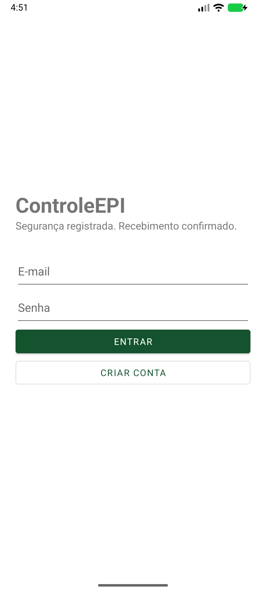
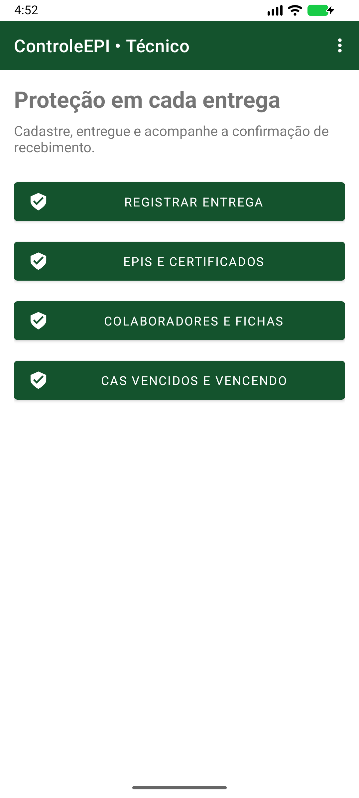
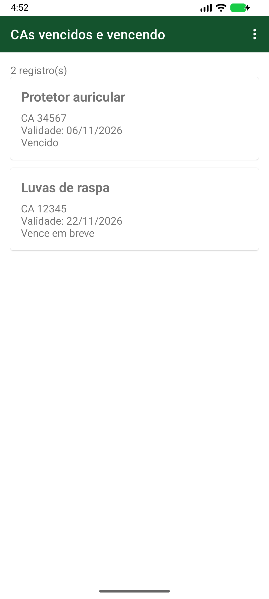

# ControleEPI

Projeto 04 de Desenvolvimento de Aplicativos Móveis

**Integrantes:** Gustavo de Souza e Gabriel Florindo

## Problema

Quando a entrega de equipamentos de proteção individual é anotada em papel, o técnico pode perder o histórico e ter dificuldade para comprovar o recebimento. O ControleEPI registra quem recebeu cada equipamento, guarda a confirmação e mostra os certificados de aprovação (CAs) vencidos ou próximos do vencimento.

O app foi feito em Java para Android, com Firebase Authentication e Cloud Firestore. O técnico cadastra EPIs e colaboradores, registra entregas e consulta fichas e vencimentos. Cada colaborador vê e confirma apenas as próprias entregas.

## Telas

| Login | Painel do técnico | CAs vencidos e vencendo |
| :---: | :---: | :---: |
|  |  |  |

Capturas do app no emulador, com dados ilustrativos.

## Configuração do Firebase

1. Abra a pasta do projeto no Android Studio. Use o JDK integrado e instale Android SDK 36 e Build Tools 36.
2. No [console Firebase](https://console.firebase.google.com/), registre um app Android com o pacote `br.edu.unisenai.controleepi`. Baixe o `google-services.json` e coloque em `app/`. Esse arquivo fica fora do Git.
3. Em **Authentication → Método de login**, habilite **E-mail/senha**. Em **Firestore Database**, crie o banco padrão em modo de produção.
4. Publique [firestore.rules](firestore.rules) e o índice de [firestore.indexes.json](firestore.indexes.json). O índice da coleção `entregas` usa `colaboradorUid` em ordem crescente e `data` em ordem decrescente. Veja o [guia passo a passo](GUIA-FIREBASE.txt). Se estiver usando o Firebase CLI autenticado, execute `firebase deploy --only firestore:rules,firestore:indexes --project ID_DO_PROJETO`.
5. Para cada conta, crie um documento `usuarios/{uid}` usando o UID de Authentication como ID. O campo string `perfil` deve valer `tecnico` ou `colaborador`. A conta do colaborador também precisa ser vinculada pelo técnico no cadastro do app.
6. No Android Studio, sincronize o Gradle e execute `app`. No Windows, `.\gradlew.bat assembleDebug` gera o APK em `app/build/outputs/apk/debug/app-debug.apk`.

## Contas de teste

| Perfil | E-mail | Senha |
| --- | --- | --- |
| Técnico | `tecnico@gmail.com` | Fornecida pela dupla em privado |
| Colaborador | `colaborador@gmail.com` | Fornecida pela dupla em privado |

Para a demonstração, entre com um perfil em cada aparelho. O técnico registra uma entrega, o colaborador confirma e o técnico acompanha a confirmação na ficha. Abra também a lista de CAs vencendo.

## Histórias e critérios de aceite

Cada issue contém a história e os critérios em Dado, Quando e Então.

| Requisito | História | Responsável |
| --- | --- | --- |
| C1 | [Cadastrar EPI #1](https://github.com/gsouzar/controle-epi/issues/1) | Gustavo |
| C2 | [Cadastrar colaborador #4](https://github.com/gsouzar/controle-epi/issues/4) | Gabriel |
| C3 | [Registrar entrega #2](https://github.com/gsouzar/controle-epi/issues/2) | Gustavo |
| C4 | [Consultar e confirmar minhas entregas #5](https://github.com/gsouzar/controle-epi/issues/5) | Gabriel |
| C5 | [Consultar ficha #3](https://github.com/gsouzar/controle-epi/issues/3) | Gustavo |
| C6 | [Consultar vencimentos #6](https://github.com/gsouzar/controle-epi/issues/6) | Gabriel |

O código entra em `develop` por PR e segue para `main` após revisão. O [PR #8](https://github.com/gsouzar/controle-epi/pull/8) reúne a versão inicial para revisão da dupla.
